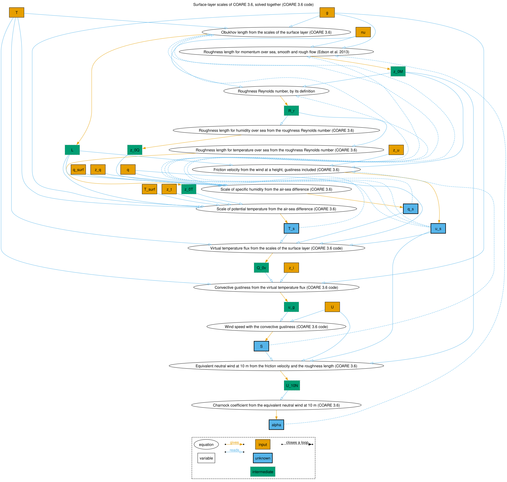
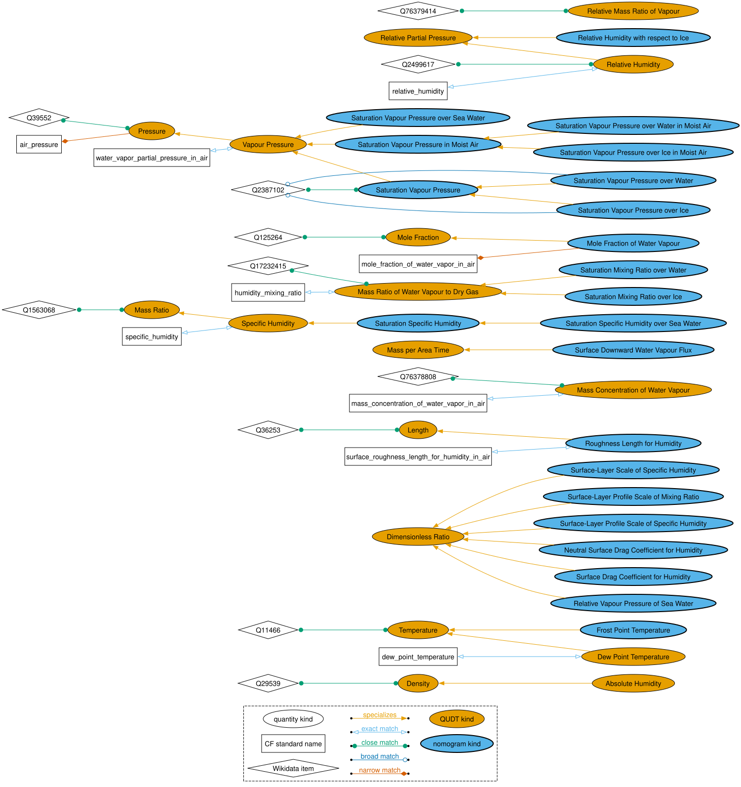
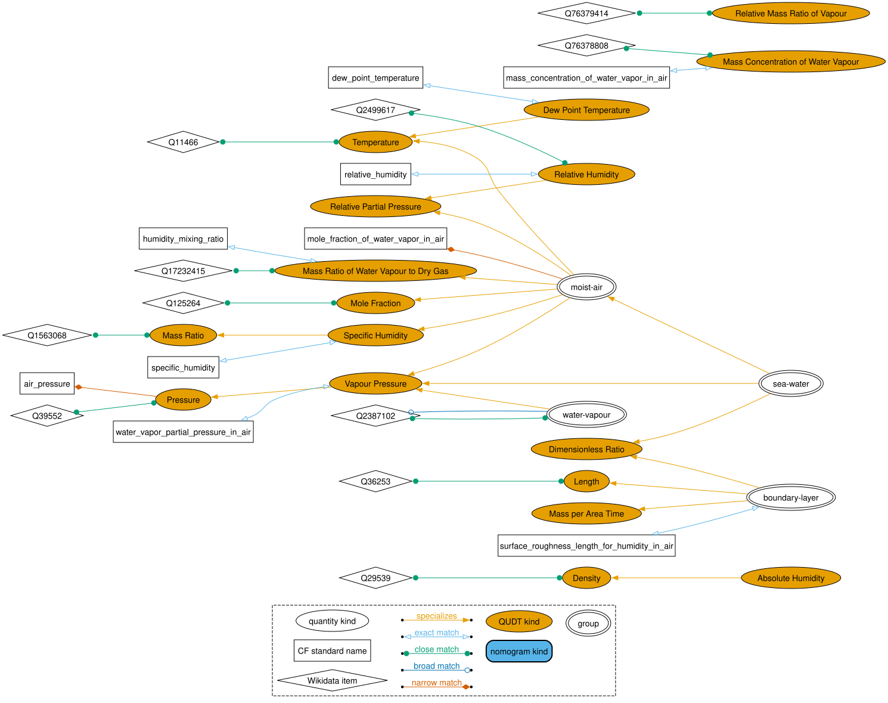

# Gallery of `protee.viz`

Drawings of node-link documents (format
[`protee-node-link/0`](../node-link-format.md)) by `protee.viz`, with the
optional extra `viz`. The documents are written by
[nomogram](https://github.com/miki4iaml/nomogram) 0.8.0 and kept in the
tests of protee (`tests/data/node_link/`); `coare` and `kinds` are those
documents, decoded from JSON. The styles come from the vocabulary each
document declares; the only style given here is `CLOSING`:

```python
CLOSING = {
    "edge": {("role", "nomogram:closing"): {"style": "dashed", "constraint": "false"}}
}
```

`viz.render_html` writes a page to explore the same documents offline
(groups folded and unfolded, tooltips, links); it is not shown here, as it
embeds the JavaScript of cytoscape.js.

This page and its drawings are written by
[`make_gallery.py`](make_gallery.py):
`uv run python docs/gallery/make_gallery.py`.

## A system of equations, in the order of its source

The surface layer of COARE 3.6: equations (ellipses) give or read variables (rectangles); inputs, unknowns and intermediates are told apart by their fill and border. The reads that close the loop are dashed and do not constrain the layout.

```python
viz.render_svg(coare, styles=CLOSING, order_by="rank", legend="below")
```



## The same system, its loop condensed

The 26 equations and variables solved together become one node, with a triple border; the inputs stay outside. In the legend, the unknowns and intermediates, which no node shown carries, take a rounded box.

```python
viz.render_svg(viz.condense(coare), styles=CLOSING, legend="below")
```


## The neighbourhood of one variable

The friction velocity and the nodes one link away; the neighbours of the selection are dashed and grey, with the number of their neighbours not shown.

```python
viz.render_svg(
    viz.select(coare, ["variables.u_s"], depth=1),
    styles=CLOSING,
    legend="below",
)
```


## A tree of quantity kinds, from right to left

Kinds of humidity and their counterparts in QUDT, the CF standard names and Wikidata; the relations of SKOS are told apart by their heads, a symmetric one drawn at both ends.

```python
viz.render_svg(kinds, direction="RL", legend="below")
```



## The same tree, one node per family

Each family (moist air, water vapour, sea water, boundary layer) is collapsed into one node with a double border.

```python
viz.render_svg(viz.collapse(kinds), direction="RL", legend="below")
```



## A legend alone

One column per declared attribute, in the order of declaration, to set beside a figure.

```python
viz.render_legend_svg(kinds)
```


