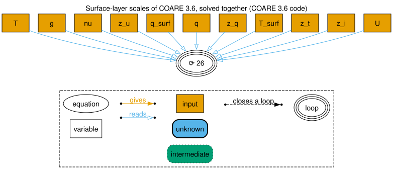
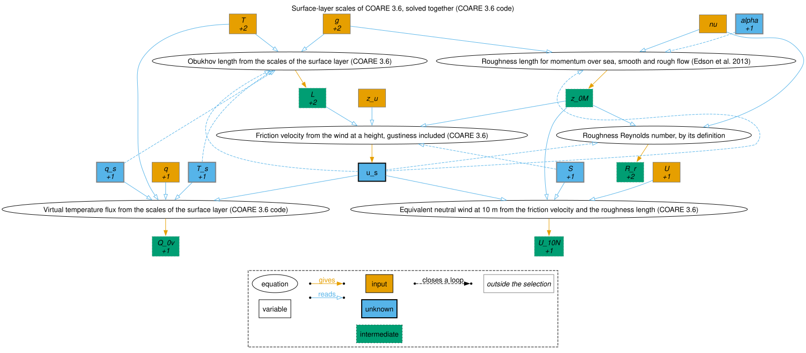
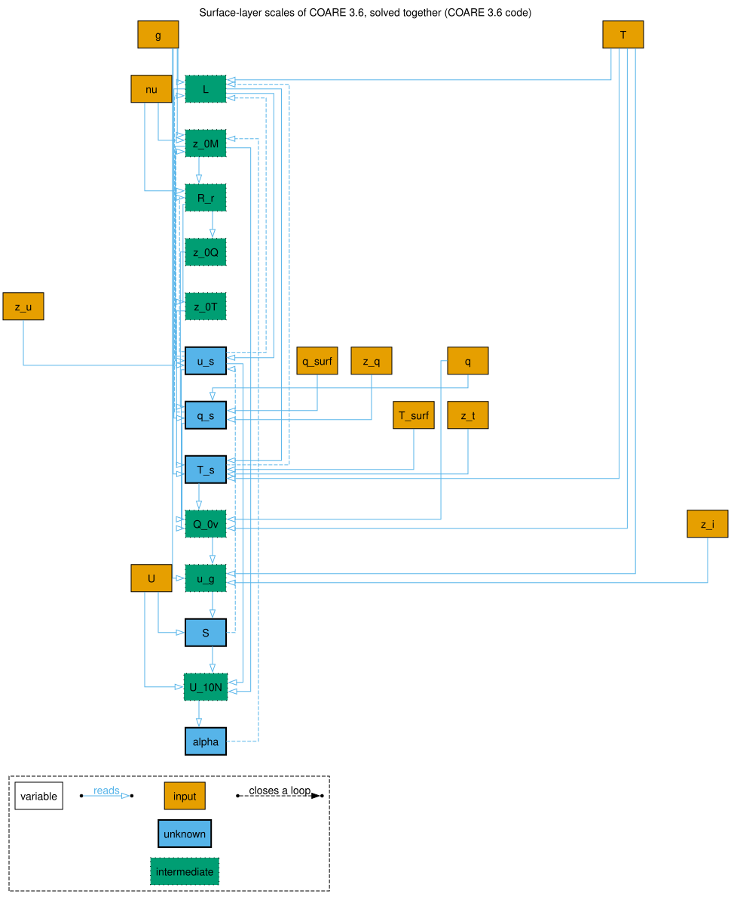
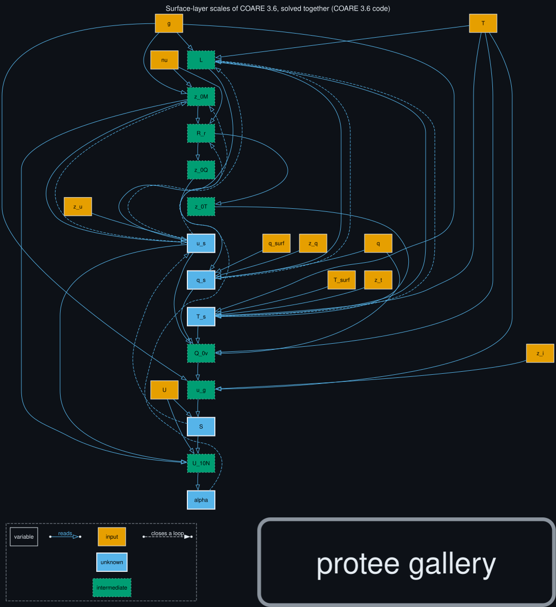
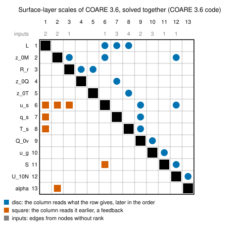
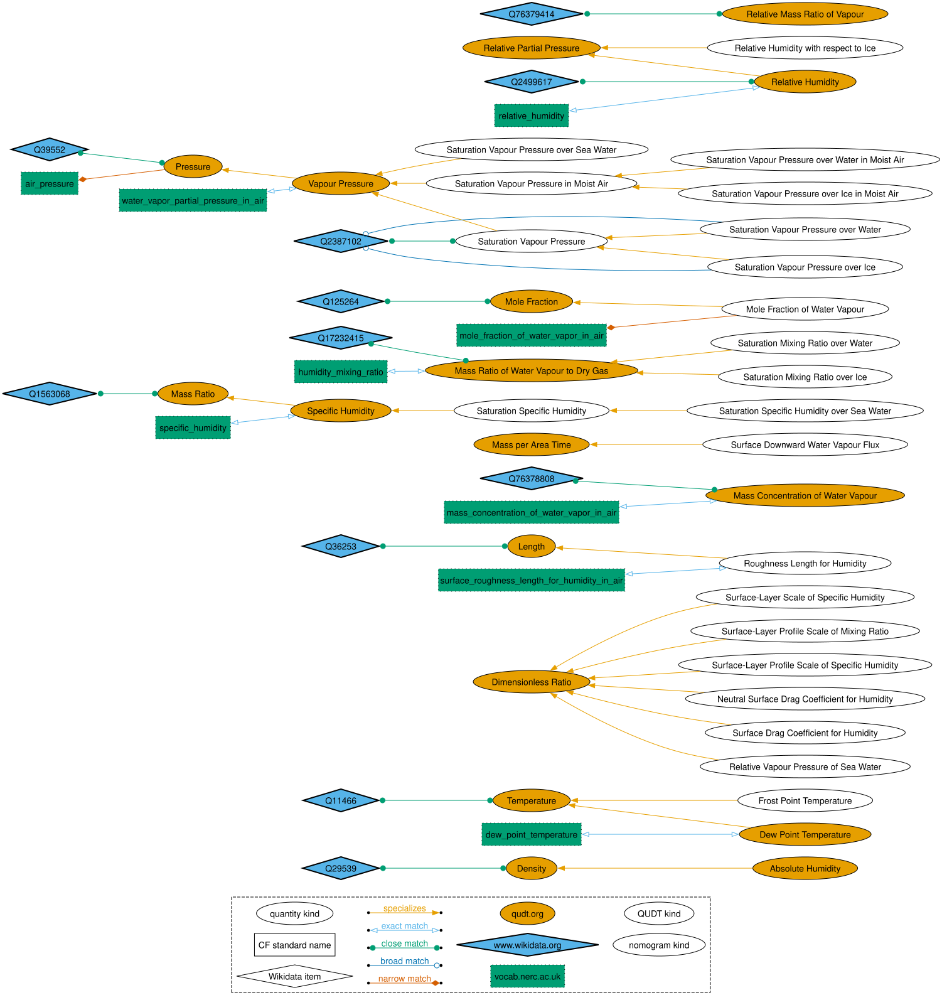
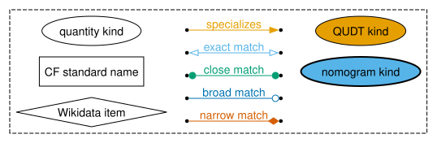

# Gallery of `protee.viz`

Drawings of node-link documents (format
[`protee-node-link/0`](../node-link-format.md)) by `protee.viz`, with the
optional extra `viz`. The documents are written by the graph export of
[nomogram](https://github.com/miki4iaml/nomogram) (producer version 0.8.0)
and kept in the tests of protee (`tests/data/node_link/`); `coare` and
`kinds` are those documents, decoded from JSON. The styles come from the
vocabulary each document declares; the only style given here is
`CLOSING`, and `MARK` is the bytes of a small SVG image made by the
script, drawn as a footer:

```python
CLOSING = {
    "edge": {("role", "nomogram:closing"): {"style": "dashed", "constraint": "false"}}
}
```

`viz.render_html` writes a page to explore the same documents offline
(groups folded and unfolded, filters by declared value and by family, a
search in the labels, tooltips on nodes and edges, formulas, links for
the nodes that have a `url`, and the matrix under the graph, coordinated
with it); it is not shown here, as it embeds the JavaScript of
cytoscape.js.

This page and its drawings are written by
[`make_gallery.py`](make_gallery.py):
`uv run python docs/gallery/make_gallery.py`.

## A system of equations, in the order of its source

The surface layer of COARE 3.6: equations (ellipses) give or read variables (rectangles); inputs, unknowns and intermediates are told apart by their fill and border. The reads that close the loop are dashed and do not constrain the layout.

```python
viz.render_svg(coare, styles=CLOSING, order_by="rank", legend="below")
```


## The same system, its loop condensed

The 26 equations and variables solved together become one node, with a triple border; the inputs stay outside. In the legend, the unknowns and intermediates, which no node shown carries, take a rounded box.

```python
viz.render_svg(viz.condense(coare), styles=CLOSING, legend="below")
```



## The neighbourhood of one variable

The friction velocity and the nodes one link away; the neighbours of the selection are dashed and grey, with the number of their neighbours not shown.

```python
viz.render_svg(
    viz.select(coare, ["variables.u_s"], depth=1),
    styles=CLOSING,
    legend="below",
)
```



## The same system, each equation joined with what it gives

Each equation and the variable it gives become one node, which keeps the variable and the rank of its equation: the loop reads from variable to variable. The legend, at the left, shows only the values that the drawing carries.

```python
viz.render_svg(
    viz.contract(coare, edge_type="nomogram:gives"),
    styles=CLOSING,
    order_by="rank",
    legend="below-left",
    legend_values="present",
)
```



## The same drawing, dark, with a footer

The dark theme, smaller texts for all nodes and edges, and an image under the drawing at the right of the legend (here a mark made by the script; a logo, or the attribution that a licence of open data asks for). The image is embedded in the drawing.

```python
viz.render_svg(
    viz.contract(coare, edge_type="nomogram:gives"),
    styles=CLOSING,
    attributes={"node": {"fontsize": "11"}, "edge": {"fontsize": "11"}},
    theme=viz.DARK,
    order_by="rank",
    legend="below-left",
    legend_values="present",
    footer=MARK,
)
```



## The same system as a matrix

The N² chart of the contracted system: the nodes on the diagonal in the order of their rank; a row gives, a column reads. The discs above the diagonal follow the order, the squares below are feedbacks: exactly the reads that close the loop, framed with the nodes they join. The top row counts the inputs of each column.

```python
viz.render_matrix_svg(
    viz.contract(coare, edge_type="nomogram:gives"),
    order_by="rank",
    loops=True,
)
```



## A forest of quantity kinds, from right to left

Kinds of humidity, in several trees, and their counterparts in QUDT, the CF standard names and Wikidata; the relations of SKOS are told apart by their heads, a symmetric one drawn at both ends.

```python
viz.render_svg(kinds, direction="RL", legend="below")
```


## The same forest, one node per family

Each family (moist air, water vapour, sea water, boundary layer) is collapsed into one node with a double border.

```python
viz.render_svg(viz.collapse(kinds), direction="RL", legend="below")
```


## The same forest, coloured by vocabulary

Each node with an IRI is marked with the vocabulary of that IRI (QUDT, the CF standard names, Wikidata), named after a declared prefix, or after the authority of the IRI when none begins it; the fill tells the vocabulary, and the legend lists them.

```python
viz.render_svg(
    viz.mark_vocabularies(kinds),
    direction="RL",
    legend="below",
    legend_values="present",
)
```



## A legend alone

One column per declared attribute and per kind of element (nodes, edges), in the order of declaration, to set beside a figure.

```python
viz.render_legend_svg(kinds)
```


